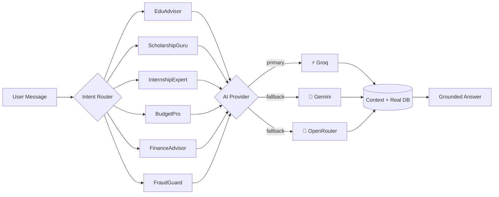
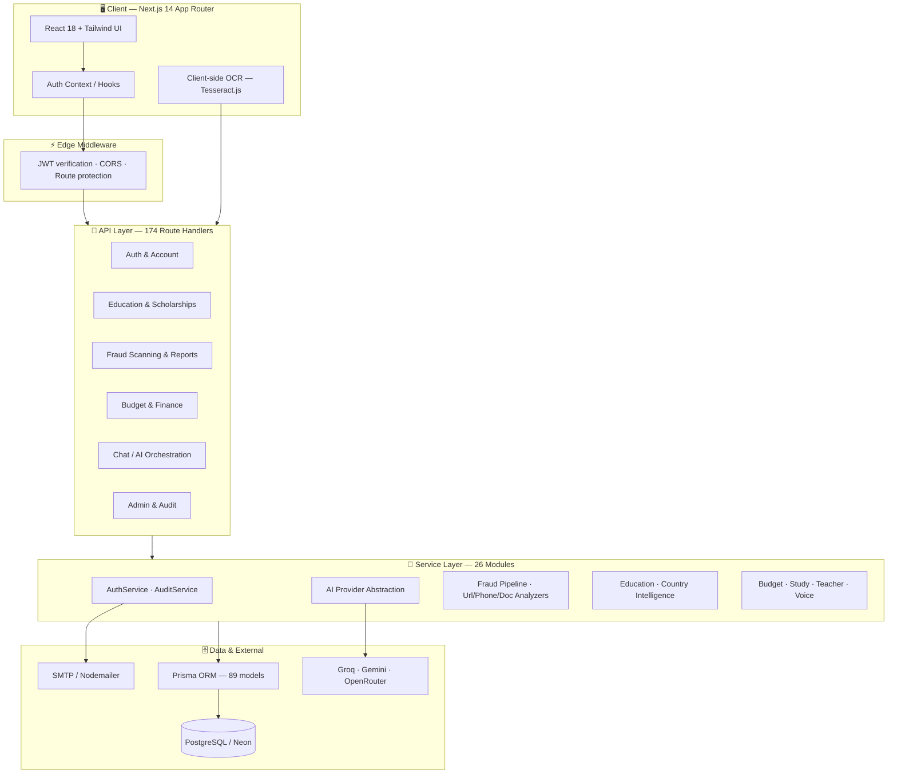

<div align="center">

# 🛡️ EduGuard AI

### 🎓 Pakistan's all-in-one **Education • Finance • Fraud Protection** platform for students

**Find the right university · Win scholarships · Manage your money · Stay safe from scams**

<br />

[](https://nextjs.org/)
[](https://www.typescriptlang.org/)
[](https://tailwindcss.com/)
[](https://www.prisma.io/)
[](https://neon.tech/)
[](https://vercel.com/)
[](#-testing--quality)
[](https://github.com/Fatimahnoman/Edu-Guard-Ai/actions)

</div>

---

## 📖 Overview

**EduGuard AI** is a full-stack, AI-powered companion built for Pakistani students. Instead of juggling a dozen websites, students get **one platform** that answers three questions:

| ❓ Question | 🎯 Answer |
|---|---|
| *"Which university and scholarship is right for me?"* | 📚 Education Center + Scholarship Matcher |
| *"How do I manage my fees, budget, and taxes?"* | 💰 Budget Tracker + FinanceAdvisor AI |
| *"Is this admission offer, link, or phone call a scam?"* | 🛡️ FraudGuard Scanners + Reporting |

It combines **6 specialized AI agents**, a **curated education database**, and a **multi-layer fraud detection engine** — all behind a secure, role-based authentication system.

> 🌟 **Built for Pakistan:** PKR amounts, HEC-recognised universities, FBR tax slabs, SBP banking rules, Islamic finance, provincial scholarship schemes, and local fraud patterns — not generic AI answers.

---

## ✨ Feature Highlights

<table>
<tr>
<td width="50%" valign="top">

### 📚 Education Center
- 🏫 University explorer — fees, merit, entry tests, programs
- 🎓 Course catalogue with eligibility & duration
- 🏆 Scholarship matcher & deadline tracker
- 🌍 Study-abroad country intelligence
- 🧭 AI career roadmaps & internships
- 🏛️ Provincial CM programs & government schemes

</td>
<td width="50%" valign="top">

### 💰 Finance & Budget
- 📊 Income, expense & savings tracking
- 🧠 AI financial health score (0–100)
- 📈 50/30/20 rule analysis
- 🏦 Tax, banking & Islamic finance guidance
- 💹 Investment, mutual funds & remittance insights
- 🎯 Actionable "what to do next" advice

</td>
</tr>
<tr>
<td width="50%" valign="top">

### 🛡️ Fraud Protection
- 🔗 **URL scanner** — phishing & fake scholarship sites
- 📞 **Phone scanner** — mobile + landline reputation check
- 📄 **Document scanner** — OCR + forgery detection
- 💬 **Text scanner** — SMS/WhatsApp/email scam patterns
- 🚨 Fraud reporting & trends dashboard
- 🏛️ Official authority contacts (FIA, HEC, FBR, SBP…)

</td>
<td width="50%" valign="top">

### 🧑‍🏫 Student & Teacher Tools
- 🗓️ Study planner, sessions & revision tracking
- 📉 Weak-subject analysis & weekly summaries
- 📝 AI lesson plans, assessments & rubrics
- 🏫 Classrooms, homework & resource sharing
- 🔊 Voice input/output (STT + TTS)
- 🌐 Bilingual — English, Urdu & Roman Urdu

</td>
</tr>
</table>

---

## 🧠 The Six AI Agents

> Every agent is a domain specialist — routed automatically by intent, with **Groq → Gemini → OpenRouter** fallback so the platform never goes dark.

| 🤖 Agent | 🎯 Domain | What it does |
|:--|:--|:--|
| **EduAdvisor** | Education | University/course guidance, admission strategy, career paths |
| **ScholarshipGuru** | Scholarships | Eligibility matching, deadlines, application guidance |
| **InternshipExpert** | Careers | Internships, fellowships, CV and career advice |
| **BudgetPro** | Money | Spending insights, savings goals, 50/30/20 coaching |
| **FinanceAdvisor** | Finance | Tax, banking, PSX, mutual funds, Islamic finance, remittance |
| **FraudGuard** | Security | Scam detection across URLs, phone numbers, documents & text |



---

## 🏗️ Architecture



### Design principles

| Principle | Implementation |
|:--|:--|
| 🔒 **Security first** | JWT access + refresh rotation, bcrypt (12 rounds), Zod validation, RBAC, audit logs |
| 🧱 **Layered** | UI → API → Service → Prisma; AI never talks to the DB directly |
| 🔌 **Provider abstraction** | AI, voice and email providers are swappable behind interfaces |
| 🧩 **Modular** | Each product area (education, fraud, budget, study…) is an isolated service |
| 🌍 **Multilingual** | Language detection and bilingual responses built into the core |
| 🎨 **Design system** | Centralised Tailwind component classes in `globals.css` |

---

## 🛠️ Tech Stack

<table>
<tr><td><b>🎨 Frontend</b></td><td>

[Next.js 14](https://nextjs.org/) (App Router) · [React 18](https://react.dev/) · [TypeScript](https://www.typescriptlang.org/) · [Tailwind CSS](https://tailwindcss.com/)

</td></tr>
<tr><td><b>⚙️ Backend</b></td><td>

Next.js Route Handlers (Node runtime) · Zod validation · JWT + bcryptjs · Nodemailer

</td></tr>
<tr><td><b>🗄️ Database</b></td><td>

[PostgreSQL](https://www.postgresql.org/) / [Neon](https://neon.tech/) · [Prisma ORM 5](https://www.prisma.io/) — **89 models**

</td></tr>
<tr><td><b>🧠 AI</b></td><td>

[Groq](https://groq.com/) (primary) · [Google Gemini](https://ai.google.dev/) (fallback) · [OpenRouter](https://openrouter.ai/) (fallback)

</td></tr>
<tr><td><b>📄 Documents</b></td><td>

pdf2json · Mammoth (DOCX) · Tesseract.js (OCR, client-side)

</td></tr>
<tr><td><b>🧪 Quality</b></td><td>

[Vitest](https://vitest.dev/) · Testing Library · ESLint · GitHub Actions CI

</td></tr>
<tr><td><b>☁️ Deployment</b></td><td>

[Vercel](https://vercel.com/) (serverless) · Docker (self-host option)

</td></tr>
</table>

---

## 📂 Project Structure

```text
Edu-Guard-Ai/
├── prisma/
│   ├── schema.prisma          # 89 models — users, education, fraud, budget…
│   ├── seed.ts                # Base seed (countries, universities, courses…)
│   ├── seed-admin.ts          # Optional admin bootstrap
│   └── seed-*.ts              # Extended datasets & demo content
├── src/
│   ├── app/
│   │   ├── (auth)/            # login · register · forgot / reset password
│   │   ├── (dashboard)/       # 76 pages — education, fraud, budget, admin…
│   │   └── api/               # 174 REST route handlers
│   ├── components/            # Reusable UI, charts, chat, scanners
│   ├── services/              # 26 domain services (auth, ai, fraud, budget…)
│   ├── lib/                   # prisma client, env schema, validators, utils
│   ├── hooks/ · context/      # Auth, theme, language providers
│   ├── middleware.ts          # JWT + CORS + route protection (Edge)
│   └── tests/                 # 57 test files — unit & integration
├── docs/                      # Architecture, reports, deployment checklist
├── scripts/                   # Data import / audit utilities
├── Dockerfile · docker-compose.yml
├── next.config.mjs            # Prisma externals · image domains
└── .github/workflows/ci.yml   # Lint → test → build
```

---

## 🚀 Getting Started

### ✅ Prerequisites

| Requirement | Version |
|:--|:--|
| 🟢 Node.js | **18+** (recommended 20/22) |
| 📦 npm | 9+ |
| 🐘 PostgreSQL | 14+ (or a free [Neon](https://neon.tech/) database) |
| 🔑 AI API key | Groq (required) · Gemini / OpenRouter (optional fallbacks) |

### 1️⃣ Clone & install

```bash
git clone https://github.com/Fatimahnoman/Edu-Guard-Ai.git
cd Edu-Guard-Ai
npm install
```

### 2️⃣ Configure environment

```bash
cp .env.example .env
```

Open `.env` and fill in the values (see the full table below).

### 3️⃣ Prepare the database

```bash
npx prisma generate     # Generate the Prisma client
npx prisma db push      # Create all tables
npm run db:seed         # Seed base data
```

### 4️⃣ Run locally

```bash
npm run dev
```

🎉 Open **[http://localhost:3000](http://localhost:3000)** — register an account and explore.

> 🗄️ Want to inspect your data? Run `npm run db:studio` and open **[http://localhost:5555](http://localhost:5555)**.

---

## 🔐 Environment Variables

| Variable | Required | Description |
|:--|:--:|:--|
| `DATABASE_URL` | ✅ | PostgreSQL connection string (`?sslmode=require` for Neon) |
| `JWT_SECRET` | ✅ | Access-token signing secret — **32+ chars** in production |
| `JWT_REFRESH_SECRET` | ✅ | Refresh-token signing secret — **32+ chars** in production |
| `JWT_EXPIRES_IN` | — | Access token TTL (default `15m`) |
| `JWT_REFRESH_EXPIRES_IN` | — | Refresh token TTL (default `7d`) |
| `GROQ_API_KEY` | ✅ | Primary AI provider key |
| `GROQ_MODEL` | — | Groq model id (e.g. `openai/gpt-oss-120b`) |
| `AI_PROVIDER` | — | `groq` (default), `gemini` or `openrouter` |
| `GEMINI_API_KEY` | — | Gemini fallback key |
| `GEMINI_MODEL` | — | Default `gemini-2.5-flash` |
| `OPENROUTER_API_KEY` | — | OpenRouter fallback key |
| `NEXT_PUBLIC_APP_URL` | — | Public URL — set to your Vercel domain after deploy |
| `CORS_ALLOWED_ORIGINS` | — | Comma-separated allowed origins |
| `SMTP_HOST` / `SMTP_PORT` | — | Email delivery (password reset, notifications) |
| `SMTP_USER` / `SMTP_PASS` | — | SMTP credentials |
| `ADMIN_SEED_PASSWORD` | — | Only for `prisma/seed-admin.ts` |

> 🔒 **Never commit `.env`.** It is git-ignored by default; use `.env.example` as the template.

---

## 🗄️ Database Commands

| Command | Purpose |
|:--|:--|
| `npm run db:generate` | Generate the Prisma client |
| `npm run db:push` | Sync schema to the database (no migration files) |
| `npm run db:migrate` | Create & apply a dev migration |
| `npm run db:migrate:prod` | Apply migrations in production |
| `npm run db:seed` | Seed base data |
| `npm run db:studio` | Open Prisma Studio GUI |
| `npm run db:reset` | ⚠️ Reset database & re-run migrations |

---

## 🧪 Testing & Quality

```bash
npm run lint            # ESLint (0 errors expected)
npm run test            # Vitest in watch mode
npm run test:run        # Run the full suite once
npm run test:coverage   # Coverage report
npm run build           # Production build + type check
```

| Check | Status |
|:--|:--|
| 🧪 Test suite | **1106 tests / 57 files — passing** |
| 🔍 ESLint | **0 errors** |
| 🏗️ Production build | ✅ Compiles successfully |
| 🤖 CI pipeline | Lint → Prisma generate → test → build |

---

## ☁️ Deploy to Vercel

EduGuard ships with a `vercel-build` script (`prisma generate && next build`), so Vercel needs **no custom build settings**.

### Steps

1. **Push** the repo to GitHub.
2. **Import** it at [vercel.com/new](https://vercel.com/new).
3. **Add environment variables** → Settings → Environment Variables:

   ```env
   DATABASE_URL=postgresql://…?sslmode=require
   JWT_SECRET=…
   JWT_REFRESH_SECRET=…
   GROQ_API_KEY=…
   GROQ_MODEL=openai/gpt-oss-120b
   AI_PROVIDER=groq
   GEMINI_API_KEY=…
   GEMINI_MODEL=gemini-2.5-flash
   OPENROUTER_API_KEY=…
   NEXT_PUBLIC_APP_URL=https://your-project.vercel.app
   CORS_ALLOWED_ORIGINS=https://your-project.vercel.app
   ```

4. **Deploy** 🚀
5. After the first deploy, update `NEXT_PUBLIC_APP_URL` and `CORS_ALLOWED_ORIGINS` with the real domain, then **redeploy**.

> 📌 The database schema is not created automatically on Vercel. Run `npx prisma db push` and `npm run db:seed` once against the same `DATABASE_URL` from your machine.
>
> ⚠️ Vercel caps request bodies at **4.5 MB** — uploads are validated against a **4 MB** limit with a friendly error message.

---

## 🔒 Security

| Layer | Implementation |
|:--|:--|
| 🔑 Authentication | JWT access (15m) + rotating refresh (7d) tokens |
| 🔒 Passwords | bcrypt hashing, 12 salt rounds, strength validation |
| 🛡️ Authorisation | Role-based access (`user` · `teacher` · `admin`), checked at middleware **and** service level |
| ✅ Input validation | Zod schemas on every API boundary |
| 📝 Auditing | Auth and admin actions written to `audit_logs` |
| 🌐 Transport | CORS allow-list, security headers (HSTS, X-Frame-Options, CSP) |
| 📄 Uploads | MIME + extension allow-list, size limits, untrusted-file handling |
| 🤐 Secrets | Environment variables only — never hardcoded, never committed |

---

## 🗺️ Roadmap

- [x] 🔐 Auth, roles, audit logging
- [x] 📚 Education, scholarships & country intelligence
- [x] 🛡️ Fraud scanners (URL · phone · document · text) + reporting
- [x] 💰 Budget tracking + AI financial coaching
- [x] 🧑‍🏫 Teacher workspace & study planner
- [x] 🤖 Multi-provider AI with automatic fallback
- [x] 🎨 Unified design system + responsive UI
- [ ] 📱 Mobile app (React Native)
- [ ] 🔔 Push notifications
- [ ] 🌐 Full Urdu localisation
- [ ] 📊 Public analytics dashboard

---

## 🤝 Contributing

1. 🍴 Fork the repository
2. 🌿 Create a feature branch — `git checkout -b feat/my-feature`
3. ✍️ Commit your changes — `git commit -m "feat: add my feature"`
4. 🧪 Run `npm run test:run` and `npm run lint`
5. 🚀 Open a Pull Request

Please keep PRs focused, include tests for new logic, and follow the existing service-layer patterns.

---

## 🙏 Acknowledgements

- [Next.js](https://nextjs.org/) · [Prisma](https://www.prisma.io/) · [Tailwind CSS](https://tailwindcss.com/)
- [Groq](https://groq.com/) · [Google Gemini](https://ai.google.dev/) · [OpenRouter](https://openrouter.ai/)
- [Neon](https://neon.tech/) · [Vercel](https://vercel.com/)
- [Tesseract.js](https://tesseract.projectnaptha.com/) · [pdf2json](https://github.com/modesty/pdf2json)

---

<div align="center">

### 🛡️ EduGuard AI

**No student should lose money to a scam, miss a scholarship deadline, or make a wrong career decision because of missing information.**

Made with ❤️ for Pakistani students 🇵🇰

<sub>© 2026 EduGuard AI · Built with Next.js 14, TypeScript & Prisma</sub>

</div>
